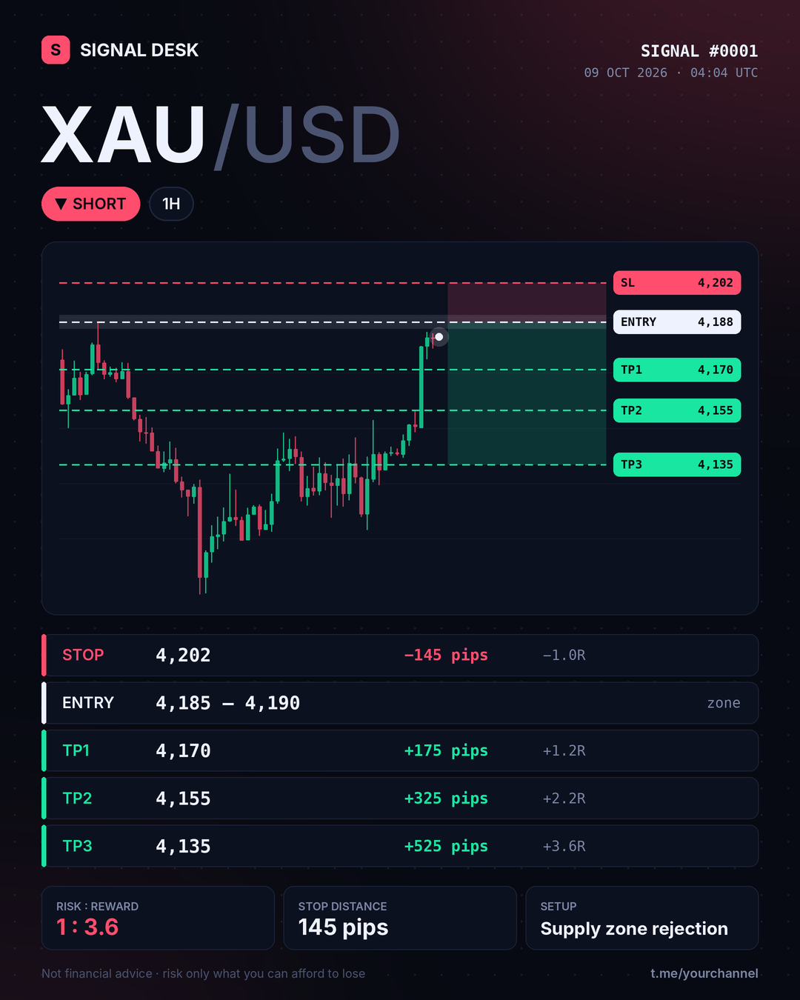
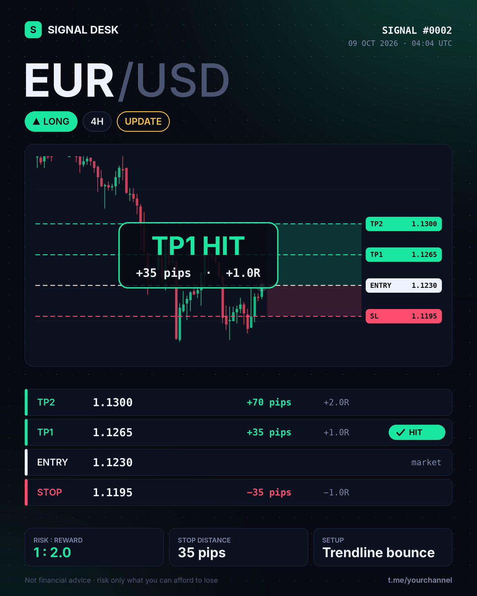
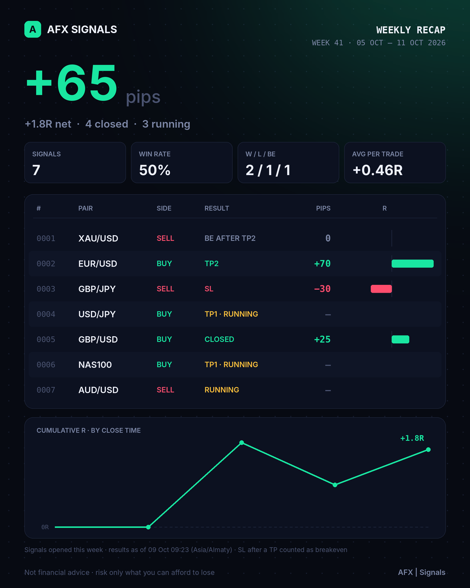

# signalbot — branded forex signal cards for Telegram

Watches the channel where your raw signals appear and posts each one into your
private group as a custom image card plus a formatted caption. When you post an
update (TP hit, stopped out, closed, cancelled), it replies to the original
signal with an updated card.

| New signal | Update (TP1 hit) |
|---|---|
|  |  |

- **Instruments:** FX pairs (EURUSD, GBPJPY…), gold/silver (XAUUSD, "GOLD"), indices/oil (US30, NAS100, SPX500, GER40, UK100, USOIL).
- **Pips:** 0.0001 for FX, 0.01 for JPY pairs, 0.1 for gold, points for indices.
- **Live chart:** recent candles at the signal's timeframe (Yahoo Finance for FX and indices, OKX's gold/silver perpetuals for metals). They're there for context; your broker's CFD prices can differ a little. If no data is available, the card is drawn without candles.
- **Safety:** levels only ever come from your post. A signal whose SL/TPs are on the wrong side of the entry is rejected, not posted.

## How it flows

```
your signal channel ──(bot reads)──▶ signalbot ──(card + caption)──▶ private group
TradingView alert ──(optional webhook)──┘
```

## 1. Set up

```bash
pip install -r requirements.txt
cp .env.example .env        # put your bot token here; .env is git-ignored
python -m signalbot chats   # post a message in the channel and the group first
```

`chats` prints the numeric ids of the channel and the group. Put them in
`.env` as `SOURCE_CHAT_ID` (the channel) and `TARGET_CHAT_ID` (the group). If the
group uses Topics, set `TARGET_THREAD_ID` to the topic number (the last part of
the topic link `t.me/c/<group>/<topic>`). Then
set `BRAND_NAME` / `BRAND_HANDLE` for the card.

Preview without posting anything:

```bash
python -m signalbot preview examples/xauusd_sell.txt examples/eurusd_buy.txt
# -> out/signal-0001.png + out/signal-0001.txt (caption)
```

Run it:

```bash
python -m signalbot relay
```

## 2. Signal formats it understands

Post these in the source channel (not case-sensitive, `:` optional):

```
XAUUSD SELL 4185 - 4190 1H        EURUSD BUY NOW @ 1.1230 4H
SL: 4202                          SL 1.1195
TP1: 4170                         TP1 1.1265
TP2: 4155                         TP2 1.1300
TP3: 4135                         Setup: Trendline bounce
Setup: Supply zone rejection
```

Also `Entry: 1.0850` / `Entry: 1.0840 - 1.0850`, `Targets: 1.09, 1.095`, up to 4 TPs,
and optional `Setup:`, `Note:` lines.

Updates (they find the latest open signal on that pair):

```
EURUSD TP1 hit ✅      GOLD SL hit      GBPJPY stopped out
EURUSD closed at 1.1250                XAUUSD cancelled
```

Anything else (commentary, news, chart screenshots without levels) is ignored.
JSON in the same schema as the webhook below works too.

## 3. Weekly results recap

Every week (default **Saturday 12:00, Asia/Almaty**) the bot posts a recap card
into the group: total pips and R, win rate, wins/losses/breakeven, every signal
opened that week with its result, and a cumulative-R curve.



Numbers come only from the bot's own records: the signals it posted and the
TP / SL / close / cancel updates you posted. Rules:

| What happened | Counted as |
|---|---|
| Last TP hit | that TP |
| SL hit, no TP before | loss (−1R) |
| SL hit after a TP | breakeven by default (`RECAP_SL_AFTER_TP=best_tp` counts the highest TP, `loss` counts −1R) |
| Closed at a price | pips to that price |
| Cancelled | not counted |
| No update yet | listed as running, not counted |

Pips are added across instruments (gold pips count like FX pips), so R is the
fairer total. No signals that week means no post. Configure with `RECAP_DAY`,
`RECAP_TIME`, `RECAP_TZ`, or turn it off with `RECAP_ENABLED=0`.

Preview this week's recap any time: `python -m signalbot recap`
(add `--post` to send it to the group now).

## 4. Optional: TradingView webhook

Run `python -m signalbot webhook --port 8080` on a host with a public HTTPS URL,
set `WEBHOOK_SECRET`, and point the alert's webhook at `https://your-host/webhook`.
Alert message:

```json
{"secret":"YOUR_SECRET","event":"open","id":"eu-{{timenow}}","ticker":"{{ticker}}",
 "interval":"{{interval}}","side":"buy","entry":{{close}},"tp_pct":[0.3,0.6],"sl_pct":0.25,
 "setup":"Trendline bounce"}
```

Fields: `ticker`, `side` (buy/sell/long/short), `entry` or `entry_low`+`entry_high`,
`tp` (list) or `tp_pct`, `sl` or `sl_pct`, optional `interval`, `setup`, `note`, `id`.
Updates: `{"secret":"…","event":"tp","tp":1,"ticker":"{{ticker}}"}`, `"event":"sl"`,
`"event":"close","price":{{close}}`, `"event":"cancel"`.

## 5. Running 24/7

The code lives on GitHub, but it needs an always-on host to run. Relay mode only
makes outgoing connections, so no public URL or domain is needed.

- **Railway / Render (deploy from GitHub):** new project → deploy this repo (it
  uses the `Dockerfile`) → add the variables from `.env.example` → attach a
  volume at `/data` so signal numbering survives restarts. Each push redeploys.
- **Any VPS (Hetzner, DigitalOcean…):** `docker build -t signalbot . && docker run -d --restart=always --env-file .env -v signalbot:/data signalbot`

Only run one copy at a time: Telegram delivers each update to one reader.

## Tests

```bash
pip install pytest && python -m pytest -q
```
